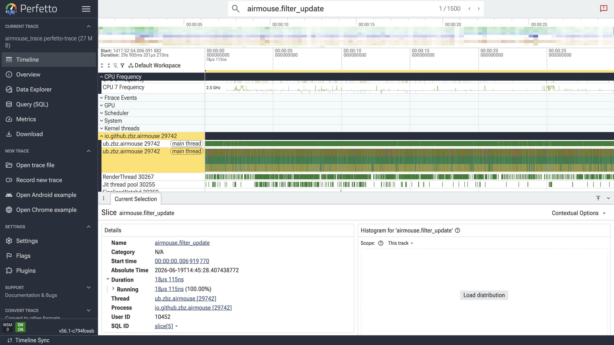
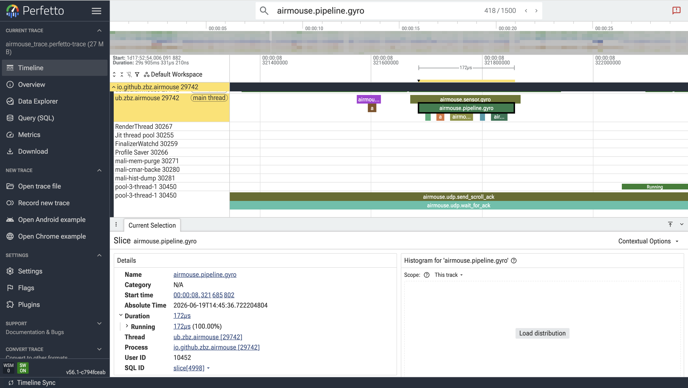
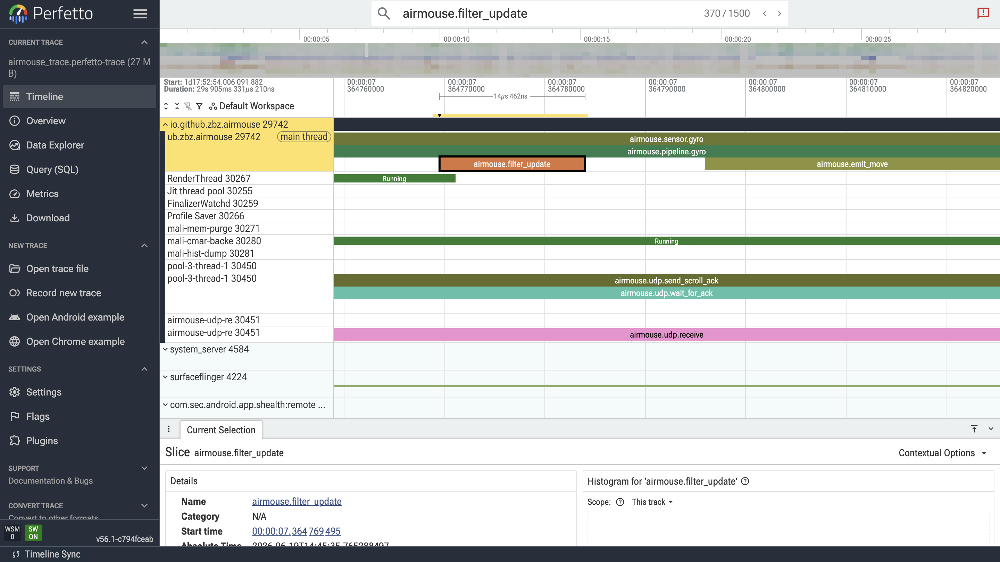
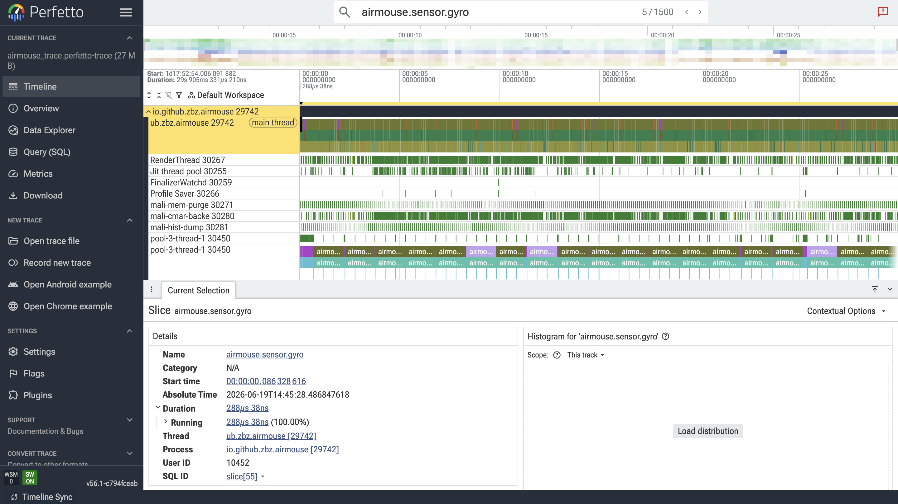
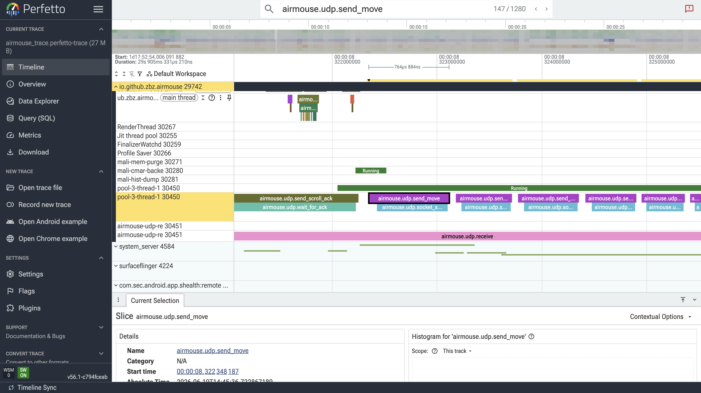
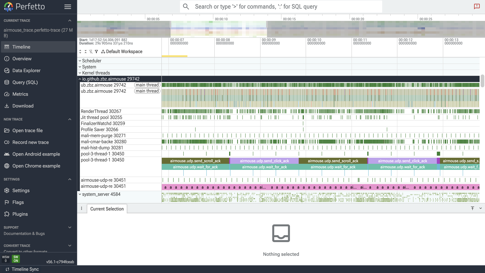
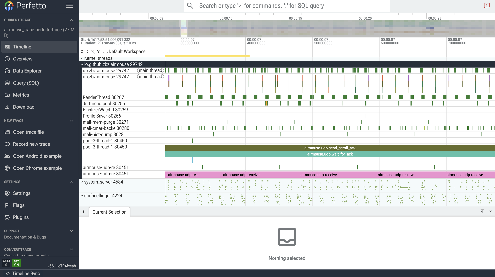

# گزارش تحلیل Perfetto

## فایل‌های مورد استفاده

- فایل trace نهایی: `perfetto_analysis/airmouse_trace.perfetto-trace`
- فایل تنظیمات Perfetto: `perfetto_analysis/config.pbtx`
- اسکریپت تحلیل عددی: `perfetto_analysis/analyze_perfetto_trace.py`

## تصاویر Perfetto UI

تصویر کلی timeline و threadها:



مسیر سنسور و pipeline ژیروسکوپ:



اجرای فیلتر:



event ژیروسکوپ:



ارسال move با UDP:



thread اصلی پردازش سنسور:



thread دریافت UDP:



## نتایج کلی Trace

نکته: داده‌های این trace روی گوشی‌ای جمع‌آوری شده‌اند که سنسورهای آن به‌درستی و با پایداری کامل کار نمی‌کردند. تست اصلی صحت عملکرد برنامه و بررسی اینکه کد به‌درستی کار می‌کند، با گوشی دیگری انجام شده است. بنابراین اعداد Perfetto در این گزارش برای تحلیل مسیر اجرا، threadها، زمان‌بندی نسبی و رفتار کلی سیستم استفاده شده‌اند و ممکن است برای ارزیابی دقت نهایی حرکت سنسورها کاملاً نماینده بهترین حالت اجرای برنامه نباشند.

```text
duration_s: 29.90533121
context_switch_count: 181125
switches_per_second: 6056.612405597898
```

## سوالات

### 1) از وقتی که درخواست خواندن داده به یک سنسور داده شده تا گرفتن داده چه اتفاقاتی در سطح سیستم عامل افتاده است؟ توضیح خود را با خروجی  Perfetto  توضیح داده و توجیه کنید. (برای این سوال میتوانید از perfetto uiاستفاده کنید

پاسخ:

در برنامه، سنسورهای خام با `SensorManager.registerListener` ثبت می‌شوند. پس از فعال شدن tracking، سیستم‌عامل اندروید داده‌های سنسور را از لایه HAL/driver دریافت کرده و event مربوطه را به فرایند برنامه تحویل می‌دهد. در trace، callbackهای سنسور با markerهای زیر دیده می‌شوند:

```text
airmouse.sensor.accel
airmouse.sensor.gyro
airmouse.sensor.mag
```

پس از دریافت event، برنامه داده را کالیبره می‌کند، فیلتر Madgwick را اجرا می‌کند، حرکت/کلیک/اسکرول را تشخیص می‌دهد و سپس داده را از طریق UDP ارسال می‌کند. مسیر اصلی پردازش در trace به شکل زیر قابل مشاهده است:

```text
airmouse.sensor.gyro -> airmouse.calibrate.gyro -> airmouse.filter_update -> airmouse.emit_move -> airmouse.udp.send_move
```

برای توجیه تصویری، فایل `airmouse_trace.perfetto-trace` در Perfetto UI باز شده و markerهای `airmouse.*` در timeline مشاهده می‌شوند. همچنین وجود eventهای `sched/sched_switch` نشان می‌دهد thread برنامه در طول اجرای callbackها توسط زمان‌بند سیستم‌عامل اجرا و تعویض شده است.

تصاویر `airmouse.pipeline.gyro_airmouse.sensor.gyro.png` و `airmouse.sensor.gyro.png` مسیر دریافت event سنسور و اجرای pipeline را نشان می‌دهند.

### 2) کارکرد سنسورهای استفاده شده را شرح دهید. توضیح دهید که سنسورهای خام چرا خطا دارند و چگونه ترکیب این سنسورها به کاهش خطا کمک کرده است.

پاسخ:

در این پروژه از شتاب‌سنج، ژیروسکوپ خام و مغناطیس‌سنج خام استفاده شده است. شتاب‌سنج برای اندازه‌گیری شتاب خطی و جهت تقریبی بردار گرانش استفاده می‌شود. ژیروسکوپ سرعت زاویه‌ای گوشی را می‌دهد و برای دنبال کردن تغییر جهت سریع مناسب است. مغناطیس‌سنج نیز جهت میدان مغناطیسی زمین را اندازه‌گیری می‌کند و برای اصلاح heading کاربرد دارد.

سنسورهای خام خطاهایی مانند noise، bias، offset، scale error و drift دارند. برای مثال ژیروسکوپ در بلندمدت drift می‌کند و اگر انتگرال‌گیری شود، خطای زاویه‌ای جمع می‌شود. شتاب‌سنج نیز به حرکت‌های ناگهانی و لرزش دست حساس است و فقط گرانش را اندازه نمی‌گیرد. مغناطیس‌سنج هم به میدان‌های مغناطیسی محیط وابسته است.

برای کاهش خطا، ابتدا کالیبراسیون انجام شده و سپس داده‌های سنسورها با فیلتر Madgwick ترکیب می‌شوند. ژیروسکوپ تغییرات سریع جهت را تأمین می‌کند، شتاب‌سنج جهت گرانش را برای اصلاح roll/pitch می‌دهد، و مغناطیس‌سنج در اصلاح جهت کلی کمک می‌کند. ترکیب این سنسورها باعث می‌شود خروجی نسبت به استفاده جداگانه از هر سنسور پایدارتر باشد.

### 3) زمان بین خواندن دو داده متوالی از سنسور درPerfetto  را با دوره نمونهبرداری که در کد خود پیکربندی نمودهاید، مقایسه کنید.

پاسخ:

در کد، سنسورها با `SensorManager.SENSOR_DELAY_GAME` ثبت شده‌اند. طبق trace، فاصله متوسط callbackهای سه سنسور تقریباً برابر است:

```text
airmouse.sensor.accel avg_period_ms: 19.94
airmouse.sensor.gyro  avg_period_ms: 19.94
airmouse.sensor.mag   avg_period_ms: 19.94
```

این مقدار تقریباً معادل نرخ نمونه‌برداری 50Hz است:

```text
1000 / 19.94 ~= 50.15 Hz
```

بنابراین مقدار مشاهده‌شده در Perfetto با نرخ مورد انتظار `SENSOR_DELAY_GAME` سازگار است.

### 4) آیا هنگام استفاده از فراخوانیهای سیستمی System Calls)، میان فعالیتهای حساس به زمان (مانند بهروزرسانی سنسورها) و پردازش های سنگین (مانند رندر گرافیکی)،    تعارضی  (یک  thread  تا زمانی که thread دیگر کار خود را تمام کند باید منتظر بماند)رخ میدهد؟   پاسخ خود را توجیه کنید.

پاسخ:

بر اساس trace، کارهای اصلی برنامه روی threadهای جدا انجام شده‌اند:

```text
sensor/filter/gesture thread: ub.zbz.airmouse
udp receive thread: airmouse-udp-re
udp send thread: pool-3-thread-1
```

میانگین زمان اجرای pipeline سنسور کم بوده است:

```text
airmouse.pipeline.gyro avg_ms: 0.270
airmouse.filter_update avg_ms: 0.021
```

ارسال move از طریق UDP نیز روی thread جدا انجام شده است:

```text
airmouse.udp.send_move avg_ms: 0.482
```

بنابراین پردازش حساس به زمان سنسورها مستقیماً توسط thread ارسال شبکه یا RenderThread بلوکه نشده است. البته در ارسال‌های نیازمند ACK مانند click و scroll، انتظار برای ACK طولانی بوده است:

```text
airmouse.udp.send_click_ack avg_ms: 1503.153
airmouse.udp.send_scroll_ack avg_ms: 1409.834
```

اما این انتظار روی `pool-3-thread-1` رخ داده و روی thread سنسور اجرا نشده است؛ پس روی نرخ callback سنسورها اثر مستقیم نگذاشته است.

تصاویر `main.png`، `ub.zbz.airmouse.png` و `airmouse-udp-re.png` تفکیک thread سنسور، thread ارسال UDP، thread دریافت UDP و RenderThread را نشان می‌دهند.

### 5) چه تفاوتی بین تعریف سنسور به صورتwake-up  وnon-wake-up  وجود دارد؟ مزایا و معایب هر کدام؟

پاسخ:

سنسور wake-up می‌تواند پردازنده را از حالت sleep بیدار کند و eventهای سنسور را حتی زمانی که سیستم در حالت کم‌مصرف است تحویل دهد. مزیت آن از دست نرفتن eventهای مهم است، اما مصرف انرژی بیشتری دارد.

سنسور non-wake-up پردازنده را بیدار نمی‌کند و eventها فقط زمانی تحویل داده می‌شوند که سیستم بیدار باشد. مزیت آن مصرف انرژی کمتر است، اما برای eventهای حساس ممکن است در حالت sleep داده‌ها دیرتر تحویل شوند یا از دست بروند.

در این پروژه، چون Air Mouse هنگام استفاده فعال و foreground است، non-wake-up برای کاهش مصرف انرژی مناسب‌تر است. اگر قرار بود کلیک یا حرکت خاص در پس‌زمینه هم از دست نرود، wake-up می‌توانست مناسب باشد، اما برای موس هوایی زنده، مصرف انرژی و تأخیر کم مهم‌تر است.

### 6) مدت زمانی را که تابع فیلتر در سطحCPU اجرا میشود را به صورت میانگین به دست آورید

پاسخ:

تابع فیلتر با marker زیر اندازه‌گیری شده است:

```text
airmouse.filter_update
```

نتیجه Perfetto:

```text
count: 1500
avg_ms: 0.021
max_ms: 0.221
```

بنابراین میانگین زمان اجرای فیلتر روی CPU حدود `0.021 ms` است.

### ۷) بیشترین مصرف پردازشی مربوط به کدام سنسور بوده است؟

پاسخ:

میانگین زمان callbackهای سنسور در trace:

```text
airmouse.sensor.accel avg_ms: 0.068
airmouse.sensor.gyro  avg_ms: 0.308
airmouse.sensor.mag   avg_ms: 0.056
```

بیشترین زمان پردازشی مربوط به مسیر ژیروسکوپ است. دلیل آن این است که callback ژیروسکوپ علاوه بر کپی داده خام، مسیر اصلی pipeline را فعال می‌کند؛ یعنی کالیبراسیون ژیروسکوپ، اجرای فیلتر Madgwick، محاسبه حرکت، تشخیص کلیک و تشخیص اسکرول بعد از event ژیروسکوپ انجام می‌شوند.

### ۸) نرخ نمونه برداری سنسورها چه تأث یری بر سایر پردازشهای سیستم ی دارد؟

پاسخ:

در trace برای هر سنسور حدود 1500 callback در مدت حدود 29.9 ثانیه ثبت شده است. این یعنی هر سنسور تقریباً با نرخ 50Hz کار کرده است. با توجه به سه سنسور، برنامه در هر ثانیه حدود 150 event سنسور دریافت می‌کند.

افزایش نرخ نمونه‌برداری باعث افزایش تعداد callbackها، افزایش تعداد اجرای فیلتر و افزایش تعداد ارسال‌های احتمالی move می‌شود. این موضوع می‌تواند باعث افزایش context switch، مصرف CPU و فشار روی thread شبکه شود. در trace نهایی تعداد context switch برابر بوده است با:

```text
context_switch_count: 181125
switches_per_second: 6056.61
```

با این وجود، چون میانگین زمان فیلتر و pipeline کم است، نرخ 50Hz برای این پروژه قابل قبول بوده و باعث بلوکه شدن آشکار پردازش سنسورها نشده است.

### 9) از آماده شدن اطلاعات سنسور تا ارسال به سرور/رایانه و مشاهده حرکت   مکان نما   متوسط چقدر زمان مصرف میشود؟

پاسخ:

در trace فعلی، markerهای مسیر سنسور تا ارسال UDP وجود دارند، اما برای اندازه‌گیری دقیق end-to-end از آماده شدن داده تا مشاهده حرکت مکان‌نما روی لپتاپ، لازم است event متناظر در سمت لپتاپ نیز ثبت و با timestamp گوشی همگام شود. با trace فعلی می‌توان زمان سمت گوشی را تا ارسال بسته UDP تخمین زد.

مسیر داخلی گوشی شامل موارد زیر است:

```text
airmouse.sensor.gyro
airmouse.pipeline.gyro
airmouse.emit_move
airmouse.udp.send_move
```

اعداد اصلی:

```text
airmouse.pipeline.gyro avg_ms: 0.270
airmouse.udp.send_move avg_ms: 0.482
```

بنابراین زمان پردازش سمت گوشی تا ارسال UDP در حالت move معمولاً کمتر از چند میلی‌ثانیه است. برای مقدار دقیق end-to-end شامل دریافت لپتاپ و حرکت مکان‌نما، باید در برنامه Python لپتاپ نیز timestamp دریافت بسته و اجرای حرکت ماوس ثبت شود.

### 10)  threadهای اصلی،threadهای سنسور،threadهای ارتباطی، پردازشی و UI چگونه تفکیک میشوند ؟   بررسی شود که هر سنسور چه نوع eventهایی تولید میکند، این eventها روی کدام threadها اجرا میشوند و چه تأثیری بر Main Threadدارند؟

پاسخ:

تفکیک threadها در trace:

```text
sensor/filter/gesture thread: ub.zbz.airmouse
udp receive thread: airmouse-udp-re
udp send thread: pool-3-thread-1
```

eventهای سنسورها:

```text
airmouse.sensor.accel -> airmouse.calibrate.accel
airmouse.sensor.mag   -> airmouse.calibrate.mag
airmouse.sensor.gyro  -> airmouse.calibrate.gyro -> airmouse.filter_update -> gesture detection -> movement
```

تمام eventهای سنسور و فیلتر در trace روی thread `ub.zbz.airmouse` ثبت شده‌اند. ارسال شبکه روی `pool-3-thread-1` و دریافت شبکه روی `airmouse-udp-re` انجام شده است. بنابراین Main/UI thread مستقیماً درگیر انتظار شبکه یا ACK نشده است. این تفکیک باعث می‌شود UI و پردازش سنسور از عملیات شبکه مستقل‌تر باشند.

### 11)  تفاوت حرکت آرام و ناگهانی تلفن همراه روی پردازش های صورت گرفته چگونه است  ؟   آیا تاخیر حرکت مکان نمای ماوس در دو حالت تفاوتی دارد؟

پاسخ:

در trace فعلی، برای بازه‌های حرکت آرام و حرکت ناگهانی marker جداگانه ثبت نشده است؛ بنابراین مقایسه دقیق این دو حالت فقط با انتخاب بازه‌های زمانی در trace یا گرفتن دو trace جدا امکان‌پذیر است. با این حال، از نظر رفتار سیستم، حرکت ناگهانی باعث تغییرات بزرگ‌تر در داده‌های سنسور و احتمالاً تولید `dx/dy` بزرگ‌تر، click یا scroll می‌شود. اما تعداد callbackهای سنسور همچنان تقریباً با نرخ ثابت 50Hz باقی می‌ماند.

برای نتیجه‌گیری دقیق، بهتر است دو trace جدا گرفته شود:

```text
slow_trace.perfetto-trace
fast_trace.perfetto-trace
```

سپس میانگین و بیشینه زمان‌های زیر در دو trace مقایسه شوند:

```text
airmouse.pipeline.gyro
airmouse.filter_update
airmouse.emit_move
airmouse.udp.send_move
```

بر اساس trace فعلی، زمان پردازش فیلتر بسیار کم است و انتظار می‌رود تفاوت اصلی بین حرکت آرام و ناگهانی در مقدار خروجی حرکت و تعداد eventهای کلیک/اسکرول باشد، نه در تأخیر اجرای فیلتر.
